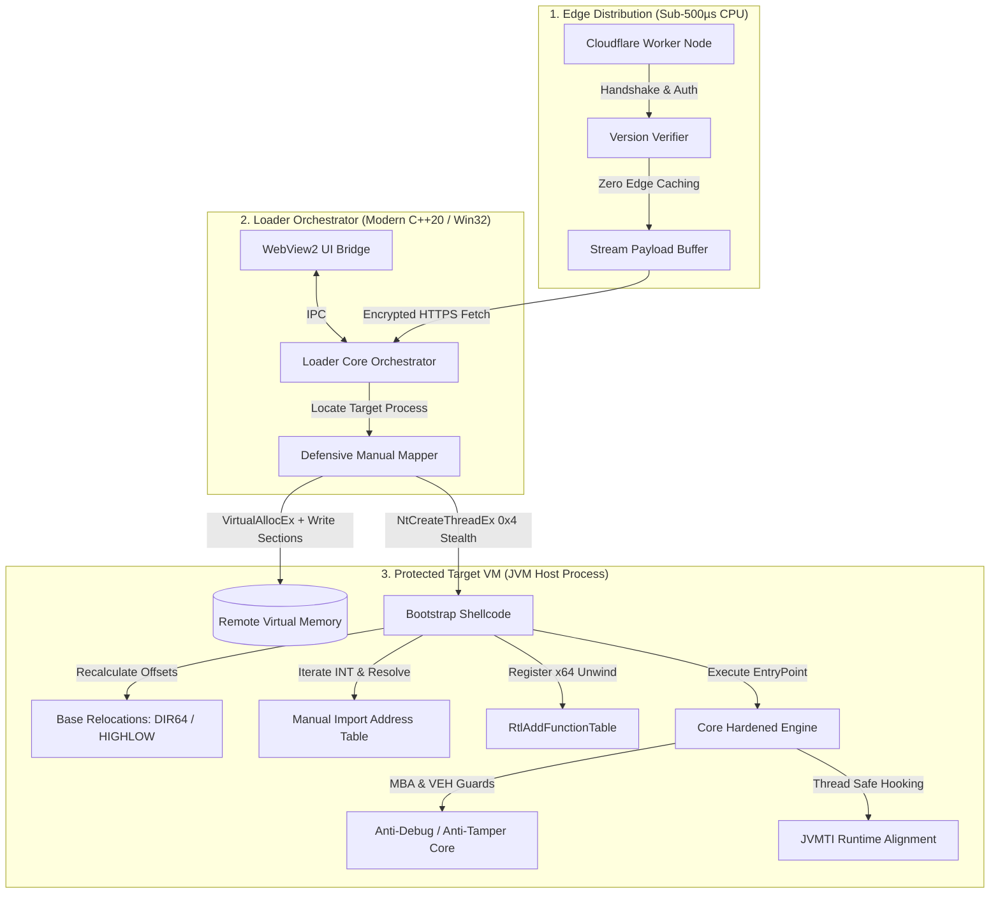
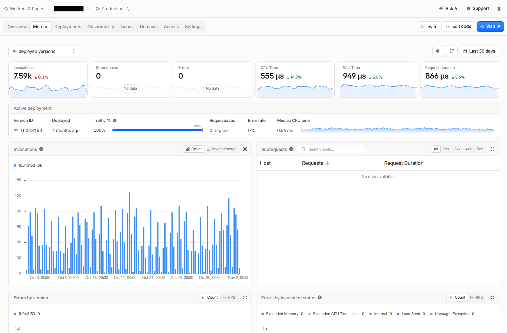
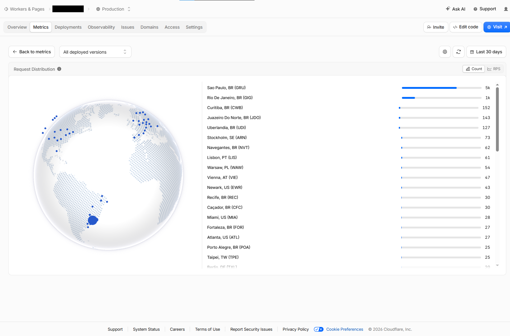

# In-Memory PE Runtime & Integrity Protection Engine
### Defensive Anti-Tamper & Zero-Disk Execution Pipeline
**Language:** Modern C++ (C++20) / Win32 / x86 & x64 Assembly  
**Discipline:** Systems Software Engineering, Windows Internals, Anti-Tamper Hardening

---

> [!NOTE]
> **Production Status, Reference POC & Intellectual Property Notice:**  
> This repository contains both an **architectural systems specification** (derived from an active production engine serving 7,500+ monthly user sessions across global edge infrastructure) and a **standalone, functional C++20 reference implementation (POC)**.  
> 
> In strict accordance with commercial non-disclosure agreements (NDAs) and anti-tamper OpSec, the public POC demonstrates the core in-memory Win32/x64 PE mapping pipeline against a neutral test fixture (`test_payload.dll`). Live target memory offsets, proprietary process hooks, private Cloudflare edge routing tokens, and commercial anti-tamper transforms are strictly omitted.

## Executive Summary

When distributing client performance software in competitive environments, on-disk libraries (`.dll`) present severe security hazards: arbitrary code injection, binary repackaging with malware, and DLL search-order hijacking. Standard OS loaders (`LoadLibrary`) exacerbate this by exposing the module directly in the process environment block (`PEB`).

This project implements a **zero-disk, in-memory execution pipeline** designed to safeguard proprietary software integrity:
- **Zero Disk Artifacts:** Payloads are fetched via ephemeral edge pipelines and mapped directly into remote virtual memory without touching the local filesystem.
- **Defensive Anti-Tamper:** Employs Mixed Boolean-Arithmetic (MBA), Anti-Symbolic Execution (ASE), and Vectored Exception Handling (VEH) to resist automated reverse engineering and decompilation.
- **Fail-Closed Architecture:** Security parameters are mathematically bound to downstream runtime execution keys, neutralizing classical single-jump assembly bypasses.

> 📄 **Looking for the complete technical breakdown?**  
> Read the full 10-minute engineering specification: **[Architecture Deep Dive & Systems Whitepaper](docs/architecture-deep-dive.md)**.

---

## Quickstart & Build (Standalone Engine POC)

Prerequisites: Windows x64, CMake 3.20+, Visual Studio 2022 / Build Tools (MSVC with C++20 support).

```powershell
# 1. Configure CMake targeting x64
cmake -B build -A x64

# 2. Build the engine runtime, runner, and test fixture DLL
cmake --build build --config Release

# 3. Execute in-memory manual map verification
.\build\Release\pe_runner.exe .\build\tests\fixtures\Release\test_payload.dll
```

### Verified Terminal Execution Output

```text
[*] Reading binary payload: .\build\tests\fixtures\Release\test_payload.dll
[+] Ingested 9728 bytes into memory
[*] Executing manual mapping pipeline:
  [payload] TLS callback executed at base 0x000001F5DA730000
    [1] PE Headers: AMD64 (x64) verified
    [2] VirtualAlloc: 0x7000 bytes committed at 0x1f5da730000
        -> Mapped 6 virtual sections
    [3] Base Relocations: 20 entries patched via DIR64
    [4] IAT Resolution: 18 imports bound
    [5] TLS Callbacks: 1 executed
    [6] SEH Unwinding: Registered via RtlAddFunctionTable
    [7] EntryPoint: 0x1F5DA731418

[*] Invoking module entry point (DLL_PROCESS_ATTACH)
  [payload] Attached to host process at base 0x000001F5DA730000
  [payload] Integrity verification token: 1515870824
[+] Entry point executed successfully (returned TRUE)
[+] In-memory execution completed without disk artifacts
```

---

## High-Level System Architecture



---

## Core Engineering Pillars

| Subsystem | Technical Implementation | Purpose / Threat Mitigated |
| :--- | :--- | :--- |
| **In-Memory PE Mapping** | Custom shellcode parsing `IMAGE_NT_HEADERS`, virtual section alignment, and ephemeral memory scrubbing. | Eliminates disk footprint, `%TEMP%` forensics, and standard `PEB` module table detection. |
| **Base Relocations** | Dynamic delta calculation traversing `IMAGE_BASE_RELOCATION` blocks for both `DIR64` and `HIGHLOW`. | Allows seamless execution at arbitrary virtual base addresses without OS relocation helpers. |
| **Manual IAT Resolution** | Iterates `OriginalFirstThunk` (INT), resolves module exports via hashing, and dynamically populates `FirstThunk`. | Obfuscates external API dependencies and eliminates cleartext import table signatures. |
| **Anti-Symbolic Hardening** | Mixed Boolean-Arithmetic (`MBA_XOR`, `MBA_ADD`) and Vectored Exception Handling (`VEH_GUARD`). | Defeats automated SMT/SAT solvers (Triton/Angr/Z3) and static linear control-flow decompilers. |
| **JVMTI Interoperability** | Asynchronous class-cache anchoring decoupled from the JVM `ClassLoader` dictionary mutex. | Solves circular AB-BA acquisition deadlocks during high-load render loop execution. |

---

## Production Scale & Telemetry Benchmarks

Continuously operated in global production via Cloudflare Workers without operational degradation:

| **30-Day Reliability & Latency (0 Errors / 555 µs)** | **Global Edge Distribution (30-Day Real Traffic)** |
| :---: | :---: |
|  |  |

- **Zero Fault Rate:** 0 unhandled exceptions or error responses across 7,590+ invocations (0.00% error rate).
- **Sub-Millisecond Compute:** Median CPU execution time of **555 µs** with an 866 µs total request duration.
- **Zero Resource Saturation:** 0 memory limit violations, 0 CPU budget throttling events, and zero uncaught runtime exceptions across global edge nodes.
- **Global Ingestion:** Real-world traffic continuously routed across edge data centers in the Americas (GRU, GIG, CWB, EWR, MIA, ATL), Europe (ARN, LIS, WAW, VIE), and Asia-Pacific (TPE).

---
## Documentation Index

- **[docs/architecture-deep-dive.md](docs/architecture-deep-dive.md):** Complete whitepaper covering PE parsing math, relocation algorithms, JVM deadlock war story, trade-off matrix, and V2 memory protection roadmap.

---

## Ethical Disclosure

This architecture was developed exclusively for **legitimate client-side performance optimization** and **proprietary IP protection against malicious payload hijacking**. Offsets and private production keys have been fully sanitized.