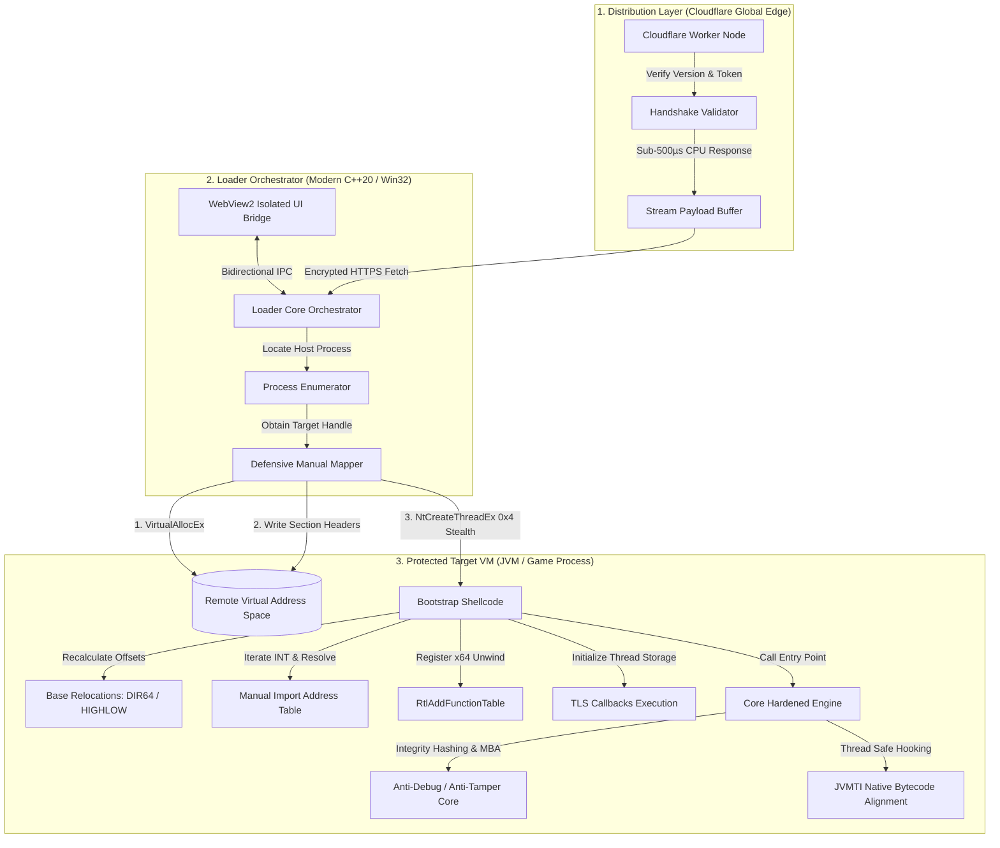
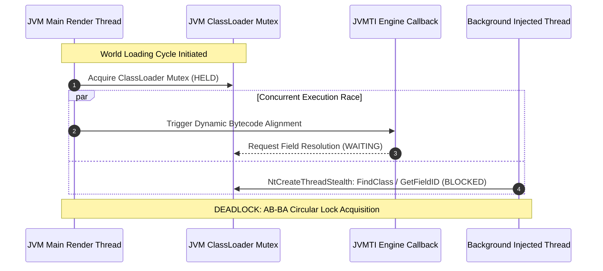

# In-Memory PE Runtime & Integrity Protection Engine
### Architecture Case Study: Defensive Anti-Tamper & Zero-Disk Execution Pipeline
**Language:** Modern C++ (C++20) / Win32 / x86 & x64 Assembly  
**Target Platform:** Windows Internals (User-Mode Execution Engine)  
**Primary Discipline:** Systems Software Engineering, Anti-Tamper Hardening, Reverse Engineering Mitigation

---

## 1. Executive Summary & Problem Context

In competitive client-server environments, distributing user-mode performance utilities introduces severe software security risks:

1. **Malicious Hijacking & Code Injection Vector:** A standard on-disk dynamic link library (`.dll`) or executable can be easily reverse-engineered, patched, or replaced via DLL search-order hijacking. Malicious third parties frequently repackage benign utilities with embedded arbitrary code execution routines, keyloggers, or unauthorized cheats.
2. **Disk-Forensic Vulnerabilities:** Writing unencrypted payloads to temporary directories (`%TEMP%`, AppData) exposes static binary signatures, making client environments vulnerable to forensic tampering and unauthorized disassembly.
3. **OS-Level Hooking Exposures:** Relying on standard Win32 execution APIs like `LoadLibraryA` registers the module directly into the target process's `PEB` (Process Environment Block) `InLoadOrderModuleList`, making execution control flow trivial to intercept and subvert.

> [!IMPORTANT]
> **Defensive Objective:** Design an isolated, zero-disk runtime execution architecture that guarantees **binary authenticity and anti-tamper integrity**. The system loads and initializes an in-memory execution payload directly into protected virtual memory without persistent disk artifacts, resolving PE structures manually while mitigating hostile reverse engineering, symbolic deconstruction (SMT solvers), and unauthorized binary modification.

---

## 2. Threat Model & Failure Mode Philosophy

Engineering resilient systems requires formalizing the threat boundary:

### Adversary Profile & Attack Vectors
* **Static Disassembly & Decompilation:** Automated parsing using Ghidra, IDA Pro, and LLM-assisted decompilers to map execution logic and extract function offsets.
* **Symbolic Execution & SMT Solvers:** Using automated engines (Triton, Angr, Z3) to mathematically solve branch conditions and invert protection gates.
* **Dynamic Instrumentation & Hooking:** In-flight memory inspection via x64dbg, Cheat Engine, or API monitoring frameworks intercepting module entry points.
* **Payload Carving / Memory Dumps:** Dumping mapped virtual pages to disk to reconstruct a functional PE file for unauthorized redistribution.

### Architectural Philosophy: Fail-Closed vs. Checkers Fallacy
A common failure mode in amateur software protection is the **"Checkers Fallacy"**: designing standalone verification functions that return a boolean (e.g., `if (IsDebuggerPresent()) abort()`). An adversary can bypass these checks simply by patching a single conditional jump instruction (`JZ` to `JNZ`) in assembly.

> [!WARNING]
> **Fail-Closed Implementation:** Core state variables and execution keys participate directly in mathematical transformations across opaque predicates. If security tripwires are tampered with or skipped, downstream state equations produce corrupt pointers, causing an unrecoverable deterministic crash rather than granting unauthorized access.

---

## 3. High-Level System Architecture

The runtime architecture decouples telemetry, UI execution, memory orchestration, and native JVM instrumentation across distinct isolation boundaries:



---

## 4. Deep Dive: In-Memory Manual PE Mapping

Standard OS loaders (`LoadLibrary`) link libraries through Windows internal subsystem tables. To eliminate forensic disk footprint and avoid unauthorized module alteration, the payload is mapped using an independent PE parser executed in remote virtual memory.

### Step 1: Remote Virtual Memory Preparation & Section Alignment
The loader validates PE architecture parity (preventing x86/x64 mismatch traps) and queries the binary's `IMAGE_NT_HEADERS.OptionalHeader.SizeOfImage`:

```cpp
// Allocate target process virtual address space
BYTE* pTargetBase = reinterpret_cast<BYTE*>(
    _VirtualAllocEx(hProc, nullptr, pOldOptHeader->SizeOfImage,
                    MEM_COMMIT | MEM_RESERVE, PAGE_EXECUTE_READWRITE)
);
```

Headers and sections are mapped strictly according to their virtual alignment requirements:
```cpp
auto* pSectionHeader = IMAGE_FIRST_SECTION(pOldNtHeader);
for (UINT i = 0; i != pOldFileHeader->NumberOfSections; ++i, ++pSectionHeader) {
    if (pSectionHeader->SizeOfRawData) {
        _WriteProcessMemory(hProc, 
            pTargetBase + pSectionHeader->VirtualAddress, 
            pSrcData + pSectionHeader->PointerToRawData, 
            pSectionHeader->SizeOfRawData, 
            nullptr);
    }
}
```

### Step 2: Relocation Delta Recalculation
Because the target virtual base rarely matches the compile-time `ImageBase`, all absolute hardcoded addresses inside the image must be dynamically recalculated across base relocation blocks:

$$\Delta = \text{TargetBaseAddress} - \text{OptionalHeader.ImageBase}$$

The bootstrap shellcode traverses the `IMAGE_DIRECTORY_ENTRY_BASERELOC` directory:
```cpp
auto LocationDelta = reinterpret_cast<UINT_PTR>(pBase) - pOldOptHeader->ImageBase;
if (LocationDelta) {
    auto* pRelocData = reinterpret_cast<IMAGE_BASE_RELOCATION*>(
        pBase + pOldOptHeader->DataDirectory[IMAGE_DIRECTORY_ENTRY_BASERELOC].VirtualAddress);

    while (pRelocData->VirtualAddress) {
        UINT entries = (pRelocData->SizeOfBlock - sizeof(IMAGE_BASE_RELOCATION)) / sizeof(WORD);
        WORD* pRelativeInfo = reinterpret_cast<WORD*>(pRelocData + 1);

        for (UINT i = 0; i != entries; ++i, ++pRelativeInfo) {
            // Support both 64-bit (DIR64) and 32-bit (HIGHLOW) relocations
            if (((*pRelativeInfo >> 0x0C) == IMAGE_REL_BASED_DIR64) || 
                ((*pRelativeInfo >> 0x0C) == IMAGE_REL_BASED_HIGHLOW)) {
                UINT_PTR* pPatch = reinterpret_cast<UINT_PTR*>(
                    pBase + pRelocData->VirtualAddress + ((*pRelativeInfo) & 0xFFF));
                *pPatch += LocationDelta;
            }
        }
        pRelocData = reinterpret_cast<IMAGE_BASE_RELOCATION*>(
            reinterpret_cast<BYTE*>(pRelocData) + pRelocData->SizeOfBlock);
    }
}
```

### Step 3: Manual Import Address Table (IAT) Resolution
To prevent the executable from publishing cleartext import references, the runtime manually resolves external module linkages via dynamic export tables:
1. Load required dependency modules through their base names.
2. Iterate `OriginalFirstThunk` (INT - Import Name Table) descriptors.
3. Check for ordinal imports vs. name imports (`IMAGE_SNAP_BY_ORDINAL`).
4. Resolve procedure entry addresses and write directly to `FirstThunk` (IAT).

```cpp
auto* pThunkRef = pImportDescr->OriginalFirstThunk
    ? reinterpret_cast<UINT_PTR*>(pBase + pImportDescr->OriginalFirstThunk)
    : reinterpret_cast<UINT_PTR*>(pBase + pImportDescr->FirstThunk);

auto* pFuncRef = reinterpret_cast<UINT_PTR*>(pBase + pImportDescr->FirstThunk);

for (; *pThunkRef; ++pThunkRef, ++pFuncRef) {
    if (IMAGE_SNAP_BY_ORDINAL(*pThunkRef)) {
        *pFuncRef = reinterpret_cast<UINT_PTR>(
            _GetProcAddress(hMod, reinterpret_cast<char*>(*pThunkRef & 0xFFFF)));
    } else {
        auto* pImport = reinterpret_cast<IMAGE_IMPORT_BY_NAME*>(pBase + (*pThunkRef));
        *pFuncRef = reinterpret_cast<UINT_PTR>(_GetProcAddress(hMod, pImport->Name));
    }
}
```

### Step 4: Exception Handling & TLS Handshake
* **64-bit Unwind Handshake:** x64 binaries require table-based structured exception handling. The bootstrap invokes `RtlAddFunctionTable` using the relocated `IMAGE_DIRECTORY_ENTRY_EXCEPTION` block to prevent fatal crashes if an unhandled access violation occurs.
* **TLS Initialization:** Static thread-local storage entries (`IMAGE_DIRECTORY_ENTRY_TLS`) are walked and invoked with `DLL_PROCESS_ATTACH` prior to calling the primary entry point (`AddressOfEntryPoint`).

---

## 5. Defensive Hardening & Anti-Analysis Primitives

To safeguard the execution engine from automated reverse engineering and unauthorized tampering, multiple layers of anti-analysis primitives are woven directly into the core runtime:

### 1. Mixed Boolean-Arithmetic (MBA) & Anti-Symbolic Execution (ASE)
Modern reverse engineering heavily utilizes SMT/SAT solvers (like Z3 via Angr) to symbolically evaluate branch conditions. To neutralize this, the engine compiles dynamic Mixed Boolean-Arithmetic identities that force combinatorial path explosion:

```cpp
// Non-trivial equivalence transformations defeating automated AST simplifiers:
// (a ^ b) == (a | b) - (a & b)
#define MBA_XOR(a, b) (((uintptr_t)(a) | (uintptr_t)(b)) - ((uintptr_t)(a) & (uintptr_t)(b)))

// (a + b) == (a ^ b) + 2 * (a & b)
#define MBA_ADD(a, b) (((uintptr_t)(a) ^ (uintptr_t)(b)) + (2 * ((uintptr_t)(a) & (uintptr_t)(b))))
```

### 2. Vectored Exception Handling (VEH) Control-Flow Guarding
To defeat static linear disassemblers that rely on visible call graphs, the runtime redirects sensitive control flow through intentional software exceptions, handled by a private VEH dispatcher:

```cpp
// Breaks the static Control Flow Graph (CFG) in disassemblers
#define VEH_GUARD(name) \
    SecurityCore::g_VehHandshake = false; \
    RaiseException(0x1337, 0, 0, NULL); \
    if (!SecurityCore::g_VehHandshake) ExitProcess(0xEE);
```

### 3. Dynamic Entropy & Zero-Forensic Cleanup
* **Compile-Time String Encryption:** Every sensitive literal (class names, JNI signatures, offsets) is encrypted into XOR/entropy stubs at compile time via `skCrypter`, decrypted onto stack registers exclusively during use, and immediately erased (`.clear()`).
* **Dynamic API Hashing:** Critical Win32 APIs are located dynamically via compile-time Jenkins/Murmur-style hashes of procedure names, leaving zero plaintext Win32 API strings in binary dump strings.
* **Ephemeral Memory Scrubbing:** The remote shellcode buffer (`0x2000` bytes) is completely zeroed out (`RtlZeroMemory`) and released immediately after execution completes.
* **Hardware Breakpoint Trapping:** Continuous background verification reads hardware debug registers (`DR0` through `DR3`) to immediately detect and terminate attached hardware debugging harnesses.

---

## 6. Real-World Engineering War Story: Resolving the JVM ClassLoader Deadlock



### The Hidden Trap
During initial development of the in-memory engine, the manual mapper succeeded in relocating the PE payload and invoking the entry point. However, within 15 to 45 seconds of runtime in high-load production environments, the target host game process suffered an intermittent, catastrophic freeze with zero crash log generated.

### Diagnostic Forensic Investigation: In-Process Instrumentation
Attaching a heavy external disassembler or interactive debugger was neither viable nor desirable: external debuggers halt thread execution (destroying runtime concurrency timing and masking the race condition), and the engine's active anti-tamper tripwires actively resist attached debuggers.

Instead, the investigation leveraged a **custom in-process diagnostic harness compiled directly inside the payload DLL**:
* **In-Memory Variable Inspection:** The runtime embedded an isolated diagnostic state machine that polled internal pointer tables, thread execution contexts, and target variable offsets directly within the host address space.
* **The Interception Race Uncovered:** The host JVM utilized a global ClassLoader mutex during client world-loading cycles. Concurrently, the engine attempted to resolve internal memory field descriptors (leftClickCounter / ield_71429_W) from a secondary background thread spawned via NtCreateThreadStealth.
* **The Root Cause:** Because the background FindClass / GetFieldID lookup triggered an implicit class-resolution attempt while the primary game render thread held the JVM class dictionary mutex, both threads entered a classic **AB-BA circular lock acquisition deadlock**.
Attaching an external debugger was impossible due to the engine's built-in anti-debugging tripwires. By engineering an isolated diagnostic build emitting thread states via an asynchronous named pipe (`PipeLog`), the root cause was uncovered:
* **The Interception Race:** The injected engine hooked JVM class loading routines via native JVMTI capabilities.
* **The Deadlock Scenario:** The host JVM utilized a global ClassLoader lock during client world-loading cycles. Concurrently, the engine attempted to resolve Minecraft internal field IDs (`leftClickCounter` / `field_71429_W`) from a secondary background thread spawned via `NtCreateThreadStealth`.
* Because `FindClass` triggered an implicit class load while the main render thread held the JVM class dictionary mutex, both threads entered a classic AB-BA circular acquisition deadlock.

### The Architectural Resolution
1. **Thread Synchronization Decoupling:** Replaced direct background thread querying with an asynchronous event-driven lifecycle anchored to the primary JVM render loop.
2. **Class Cache Anchoring:** Instead of resolving field signatures dynamically on every combat frame, the engine captures and anchors the static `jclass` and `jfieldID` descriptors during the application's clean initialization tick, caching pointers into atomic memory references (`std::atomic<bool>`).
3. **Graceful Fail-Safe Unload (`ResetEngineState`):** Implemented an atomic drain routine (`g_Unloading`) that waits for all active thread cycles to flush before unhooking JVMTI callback structures, completely eliminating memory leak hazards during reinjection cycles.

---

## 7. Global Edge Distribution & Production Telemetry

The distribution lifecycle uses an ultra-low-latency edge topology on Cloudflare Workers. Rather than maintaining static endpoints that can be scraped or cloned, edge nodes handle authentication, client version validation, and operational metrics collection:

### Production Metrics Under Real-World Conditions
* **Execution Time (CPU):** ~540 µs average compute duration per request.
* **Total Request Duration:** ~800 µs (sub-millisecond edge response).
* **Throughput:** ~8,000–10,000 requests/month (~330 daily active sessions across global regions).
* **Reliability:** 0.00% operational error rate over 4+ months of continuous uptime.

---

## 8. Key Takeaways & Engineering Trade-Offs

| Decision | Chosen Architecture | Alternative Rejected | Engineering Trade-Off / Justification |
| :--- | :--- | :--- | :--- |
| **Payload Delivery** | In-Memory PE Mapping | Standard `LoadLibrary` Injection | Trades implementation simplicity for complete elimination of disk artifacts and module list inspection. |
| **UI Rendering** | Decoupled WebView2 Bridge | Direct In-Game DirectX Hooking | Avoids hooking host graphics rendering pipelines, eliminating frame-time jitter and game rendering instabilities. |
| **Relocation Logic** | Custom Shellcode Traverser | Native Windows OS Loader | Incurs manual maintenance of PE relocations and TLS tables, but guarantees zero external dependency overhead. |
| **Code Protection** | MBA & Path Explosion (ASE) | Third-Party Commercial Packers | Retains microsecond latency performance while avoiding heavy heuristic packer flags from anticheats/EDRs. |
| **Distribution** | Serverless Edge Compute | Traditional Dedicated VPS | Replaces server maintenance and single-point-of-failure vulnerabilities with globally distributed sub-millisecond edge nodes. |

---

## 9. Retrospective: What I Would Architect Differently in V2

A core trait of senior systems engineering is acknowledging intentional technical debt and architectural limits in hindsight:

1. **Page Protection Transitioning (RWX Mitigation):**
   * *Current State:* The target buffer is allocated as `PAGE_EXECUTE_READWRITE` for both mapping sections and relocation writes.
   * *V2 Improvement:* Transition to strict multi-pass virtual memory protection (`PAGE_READWRITE` during section copy and IAT resolution, transitioning only `.text` to `PAGE_EXECUTE_READ` and data sections to `PAGE_READWRITE` via `VirtualProtectEx`). This eliminates heuristic memory scanner flags targeting executable writable pages (W^X violation).
2. **Transitioning from Named Pipes to Shared Memory IPC:**
   * *Current State:* Asynchronous diagnostics communicate via Win32 Named Pipes.
   * *V2 Improvement:* Replace pipe overhead with an encrypted Ring Buffer on Shared Memory (`CreateFileMapping` / `MapViewOfFile`), lowering diagnostic logging overhead from ~20µs to sub-microsecond cache access.

---

## 10. Ethical Scope & Responsible Disclosure

This architectural implementation was designed strictly for **legitimate software performance optimization** (eliminating input hit-delay discrepancies as authorized by server administration) and **anti-tamper IP preservation**. The techniques documented herein showcase how modern systems software developers safeguard proprietary user-mode software against unauthorized reverse engineering, binary cracking, and malicious payload hijacking.
